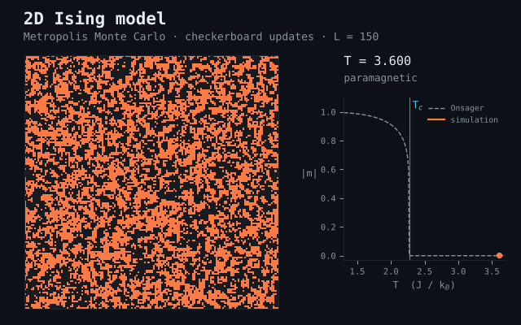
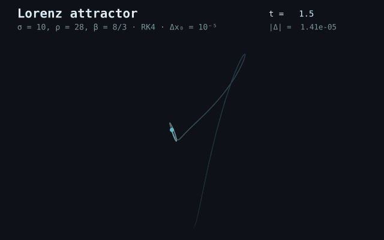

Biological Engineering student at the Universidad Nacional de Colombia.
I work on the mathematics and computation underneath natural phenomena, mostly in **Rust**.

  
  
  

Generated by my own code — see <a href="scripts/">scripts/</a>.

### Building

| | | |
|---|---|---|
| **[Cista](https://github.com/thaleoo/cista)** | Encrypted password manager for the terminal | `active` |
| **Atrio** | End-to-end encrypted messaging in the terminal | `in development` |
| **Computational physics** | Ising model, Monte Carlo, phase transitions | `ongoing` |

### Elsewhere

[LinkedIn](https://www.linkedin.com/in/jj-osorio) · [ORCID](https://orcid.org/0009-0000-0240-7005)
