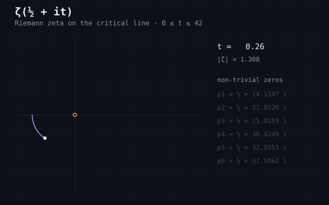
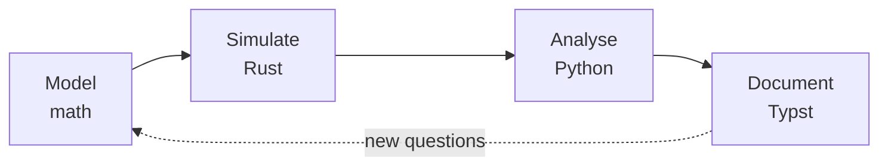
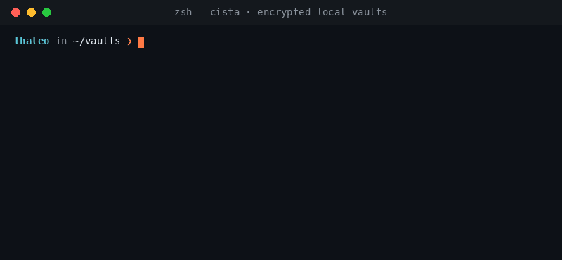
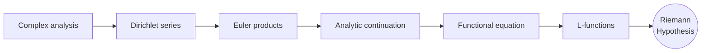

<div align="center">


<br/>

<a href="https://www.linkedin.com/in/jj-osorio"></a>
<a href="https://orcid.org/0009-0000-0240-7005"></a>


<br/><br/>

<a href="#-numerical-experiments"></a>

</div>

---

## `$ cat about.md`

I'm **Thaleo Osorio** (academically **Juan J. Osorio-Díaz**), a Biological Engineering undergraduate at the **Universidad Nacional de Colombia, La Paz campus** — and an aspiring interdisciplinary researcher and software developer.

My degree is biological; my obsession is **the mathematics and computation underneath natural phenomena**. I want to understand how things work at a fundamental level, build the tools to investigate them, and eventually contribute original ideas to science and technology.

A typical loop for me: study a mathematical model → implement the simulation in **Rust** → analyse it in **Python** → document the whole experiment, reproducibly, in **Typst**.

```rust
pub struct Thaleo {
    pub degree:    &'static str,          // "Biological Engineering @ UNAL"
    pub thinks_in: [&'static str; 4],     // math, physics, CS, engineering
    pub builds_in: [&'static str; 3],     // Rust, Python, Typst
    pub principle: &'static str,          // "Understanding > applying"
}

impl Thaleo {
    pub fn goal(&self) -> &str {
        "Researcher and educator: contribute knowledge, make rigour accessible."
    }
}
```

---

## 🧭 Research interests

<table>
<tr>
<td width="33%" valign="top">

### ∑ Mathematics
- Real & complex analysis
- **Analytic number theory** — ζ(s), the Riemann Hypothesis
- Infinite series & convergence
- Special functions
- (Numerical) linear algebra
- Differential equations
- Mathematical methods for physics

</td>
<td width="33%" valign="top">

### ⚛ Physics
- Statistical mechanics
- **Phase transitions & critical phenomena**
- Computational & condensed-matter physics
- Quantum mechanics
- Nonlinear & classical dynamical systems
- Emergent behaviour from simple rules

</td>
<td width="33%" valign="top">

### 🔐 Computing & security
- **Systems programming in Rust**
- Scientific computing & algorithms
- Cryptographic engineering
- **Post-quantum cryptography**
- Secure messaging protocols
- ML systems, AI security, software provenance

</td>
</tr>
</table>

---

## 🔬 Numerical experiments

> Every animation on this page is generated from my own code — no stock GIFs. The scripts live in [`scripts/`](scripts/) so anyone can reproduce them.

<table>
<tr>
<td width="50%" valign="top">


**2D Ising model.** A 150×150 lattice annealed from the paramagnetic phase through T<sub>c</sub> = 2/ln(1+√2) ≈ 2.269 with Metropolis checkerboard updates. Domains grow and the magnetisation is compared against Onsager's exact solution — the lag behind the curve is real finite-time relaxation, not a bug.

</td>
<td width="50%" valign="top">


**Lorenz attractor.** Two trajectories that start 10⁻⁵ apart, integrated with RK4. They trace the same strange attractor but separate exponentially — deterministic chaos and sensitive dependence on initial conditions in one picture.

</td>
</tr>
<tr>
<td width="50%" valign="top">



**ζ(½ + it).** The Riemann zeta function traced along the critical line for 0 ≤ t ≤ 42. Each time the curve passes through the origin we hit a non-trivial zero (14.1347…, 21.0220…, …). This is the object at the centre of my analytic number theory roadmap.

</td>
<td width="50%" valign="top">

### What's next on the bench
- [ ] Finite-size scaling & critical exponents for Ising (Rust core, Python analysis)
- [ ] Wolff cluster algorithm vs. Metropolis near T<sub>c</sub>
- [ ] Site percolation and the spanning threshold
- [ ] Brownian motion & diffusion
- [ ] Time-dependent Schrödinger equation (split-step Fourier)

**Workflow**



</td>
</tr>
</table>

---

## 🛠 Projects

### 🔑 [Cista](https://github.com/thaleoo/cista) — local, encrypted password manager &nbsp;  



Your credentials live in a single `*.cista` file — without the master password it's just bytes. Educational, but built with real cryptographic practice rather than toy implementations:

| Layer | Choice |
|---|---|
| Key derivation | **Argon2id** (64 MiB, 3 iterations) |
| Encryption | **XChaCha20-Poly1305** AEAD, file header authenticated as AAD |
| Secrets in memory | `secrecy` + `zeroize` — wiped on drop; best-effort `mlockall`, core dumps disabled |
| UX | CLI + REPL session + Ratatui TUI, auto-lock, clipboard auto-clear, password health (zxcvbn) |
| Architecture | Cargo workspace: `cista-core` · `cista-cli` · `cista-tui` |

> *Demo above uses the real `cista` binary output; only the typing is animated.*

<br/>

<table>
<tr>
<td width="50%" valign="top">

### 💬 Atrio
**End-to-end encrypted terminal messenger** ·  

Secure communication without depending on centralised commercial services.
- **X3DH** key agreement + **Double Ratchet**
- **Ed25519** identities · **X25519** key exchange
- Async networking · **Ratatui** TUI
- Next: post-quantum KEMs, optional Tor transport

</td>
<td width="50%" valign="top">

### 🎞 Animath
**Programmable mathematical animation** ·  

Making mathematical communication *programmable, precise and reproducible*.
- Geometric constructions & typeset expressions
- Function plots and physical vector fields
- Scientific diagrams and animated explanations

</td>
</tr>
<tr>
<td width="50%" valign="top">

### 🧲 Computational Physics
**Numerical experiments collection** ·   

Theory → implementation → numerical results → interpretation. Centred on the 2D Ising model: Monte Carlo, critical temperature, finite-size scaling and universality.

</td>
<td width="50%" valign="top">

### 🧠 ADNI · MCI → Alzheimer's
**Clinical ML / data analysis** ·  

Academic project on the Alzheimer's Disease Neuroimaging Initiative: longitudinal clinical data, missing-value analysis, statistical testing, EDA and ML-ready preprocessing to study progression from mild cognitive impairment.

</td>
</tr>
</table>

### 🌱 Synapse — open knowledge & student research
An initiative for students to be **active contributors** to research and technology, not passive consumers: open-source projects, collaborative research and shared academic resources. **#KnowledgeMustBeFree**

---

## 🗺 Roadmap · analytic number theory



Learning these rigorously — as one connected structure rather than isolated curiosities.

---

## 🧰 Toolbox

<div align="center">


<br/><br/>


</div>

| Area | Tools |
|---|---|
| **Daily drivers** | Rust · Python · Bash · Fedora Linux · Zsh · Git · terminal-first workflow |
| **Science stack** | NumPy · pandas · statistical analysis · numerical simulation · data visualisation |
| **Writing** | Typst for research notes & papers · LaTeX · Markdown |
| **Actively learning** | Cryptographic engineering · post-quantum crypto · ML systems · embedded electronics |

---

## ⚖️ How I work

| Principle | In practice |
|---|---|
| **Rigour** | Mathematical correctness, evidence and well-founded arguments. |
| **Understanding** | I want to know how a tool is built, why it works and where it breaks — not just how to call it. |
| **Reproducibility** | If others can't inspect and rerun it, it isn't finished. |
| **Craftsmanship** | Clean architecture, maintainable code, honest documentation. |
| **Open knowledge** | Open source, accessible resources, collaborative learning. |

<details>
<summary><b>Beyond the terminal</b></summary>
<br/>

Electronics & DIY engineering · embedded systems · robotics & human–machine interaction · astronomy & astrophysics · chess · calisthenics · minimalist, functional design · open hardware.

</details>

---

<div align="center">

<picture>
  <source media="(prefers-color-scheme: dark)" srcset="https://raw.githubusercontent.com/thaleoo/thaleoo/output/snake-dark.svg"/>
  <source media="(prefers-color-scheme: light)" srcset="https://raw.githubusercontent.com/thaleoo/thaleoo/output/snake.svg"/>
  
</picture>

<br/>

<sub><i>Understanding, constructing and exploring systems through mathematics, science and computation.</i></sub>

</div>
